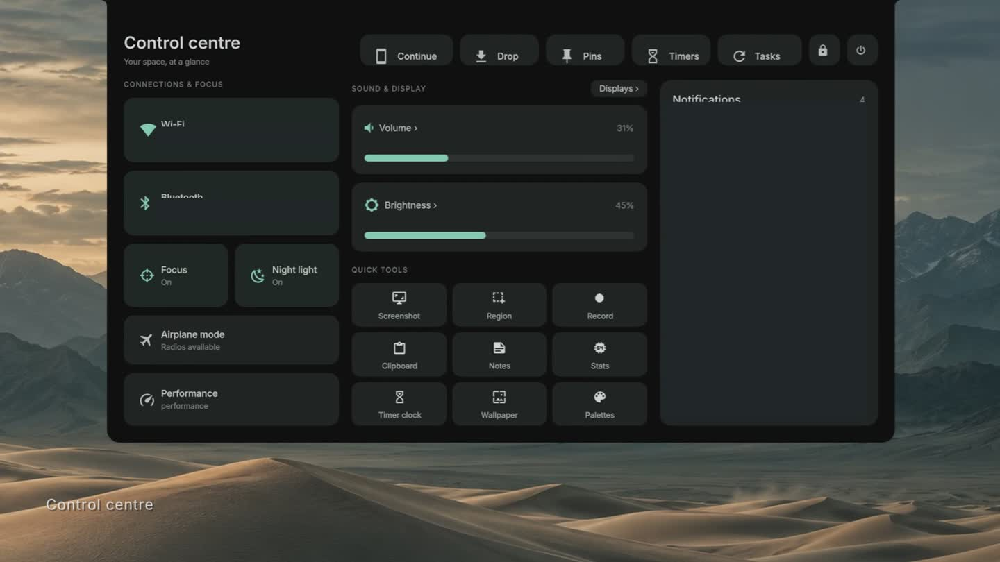

# Aether

My Hyprland shell. The clock stays in the middle, the current app sits on the left, and minimized windows live on the right. Everything opens out of the same island.

[](https://0xquerencia.github.io/aether/)

**[Watch the full showcase](https://0xquerencia.github.io/aether/)** · [Download the video](https://github.com/0xQuerencia/aether/releases/download/v0.1.0/Aether-showcase-with-text.mp4) · [Setup guide](docs/SETUP.md)

A few private details are covered in the video. It shows my desktop; the installer adds the shell to yours. Your monitor setup, terminal and prompt stay as they are.

## What's in here

The island handles the launcher, control center, notifications, media and timers. You can drop a file onto it for image/video actions, zip a folder, or send something to a nearby receiver. Longer jobs run as tasks and leave a result when they're done.

There's also an overview, clipboard history, emoji picker, notes, screen pins, recording controls and wallpaper palettes. Most of it is reachable from the control center.

Warp is optional. It makes windows open from the island and fold back into their minimized slots. Reduced motion turns the effect off.

## Install

I run CachyOS with **Hyprland Lua 0.56.2** and **noctalia-qs 0.0.12**. That's the combination tested here. Aether is its own QML shell, not the Noctalia shell. `noctalia-qs` is the Quickshell runtime package installed on my machine; Aether uses its Polkit module. Upstream Quickshell hasn't been tested.

```bash
git clone https://github.com/0xQuerencia/aether.git
cd aether
./tools/dependencies.sh --apply
python3 tools/doctor.py
./install.sh
```

The installer has a small menu. Pick wallpapers and warp if you want them, check the file preview, then install. Anything it replaces gets backed up first. It doesn't start the shell or edit your Hyprland config for you.

Matugen, awww and noctalia-qs may need extra package sources on plain Arch. The dependency helper reports what's missing instead of installing an AUR helper for you. See [setup](docs/SETUP.md) if one of those isn't in your repositories.

Next, review `~/.config/aether/integration.lua` and load it from your Hyprland Lua config:

```lua
dofile(os.getenv("HOME") .. "/.config/aether/integration.lua")
```

It contains the startup hook and keybinds. Check for conflicts with your own bindings, especially if you use submaps. Stop your existing shell, then run `aether-session` to try Aether in the current session.

For a file preview without the menu:

```bash
./install.sh --plain
```

Or use the flags directly:

```bash
./install.sh --apply --wallpapers --with-warp
```

## Warp

Warp is built from source against your installed Hyprland headers. I don't ship a compiled plugin. The loader checks the build against the compositor you're running and falls back to normal window behavior if they don't match.

After installing it, run `aether-warp load` inside Hyprland. Rebuild it after a Hyprland update. [Build notes](docs/WARP.md).

## Keybinds

These come from the integration file. Change them if they overlap with yours.

| Key | Opens |
| --- | --- |
| Alt+Space | Launcher |
| Super+I | Settings |
| Super+Tab | Overview |
| Super+Period | Emoji picker |
| Super+V | Clipboard |
| Alt+W | Wallpapers |
| Alt+P | Palettes |
| Super+Shift+N | Minimize into the island |
| Super+Alt+N | Minimized windows |

Your existing lock binding stays yours.

## Undo

The installer prints a backup path when it finishes. To restore that install:

```bash
aether-session stop
./install.sh --rollback "$HOME/.local/state/aether-installer/backups/TRANSACTION_ID"
systemctl --user daemon-reload
```

Rollback checks the files first. If you've edited them since installing, it stops so it won't overwrite your work. Package installs are separate and aren't removed by rollback.

## A few things to know

- This release is a shell add-on, not my whole home directory. No voice assistant, API keys, histories, paired-device data or personal app configs are included.
- The shell uses `~/.config/hypr/scripts/quickshell`. If you already have something there, it will be backed up and replaced.
- Wallpaper colours use Aether's own Matugen config. Your terminal/editor themes aren't changed.
- The headphone product photograph from my desktop isn't bundled. The public version has a generic fallback.
- The installer and rollback have nine automated checks. The exported shell was also loaded in a nested Hyprland session. A fresh-machine install and more hardware testing are still needed. [What was tested](docs/VALIDATION.md).

## Working on it

```bash
python3 tools/audit.py
python3 -m unittest discover -s tests -v
```

Original Aether code and configuration are [MIT licensed](LICENSE). Dependencies and third-party media keep their own rights. [Credits](NOTICE.md).
